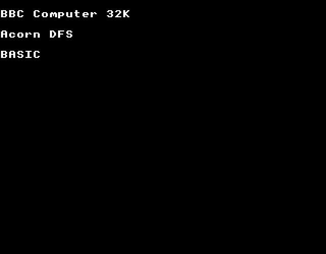
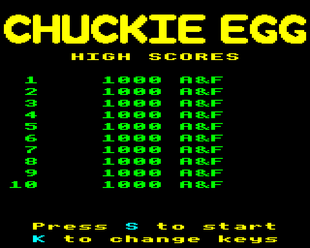
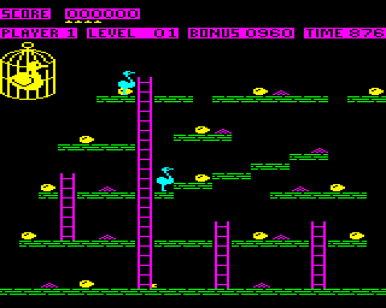
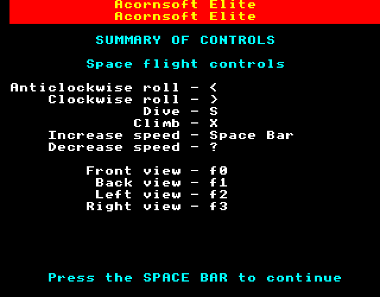
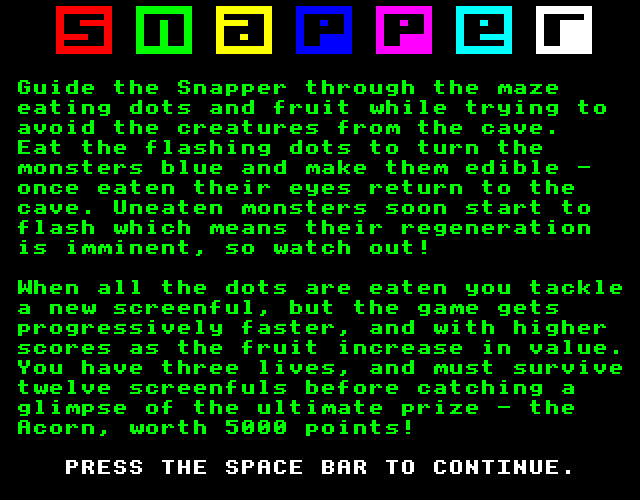
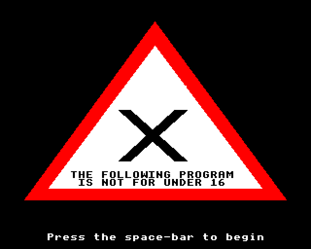
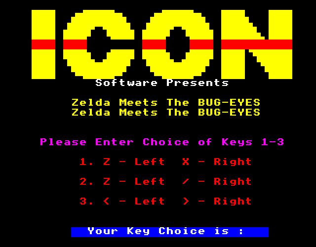
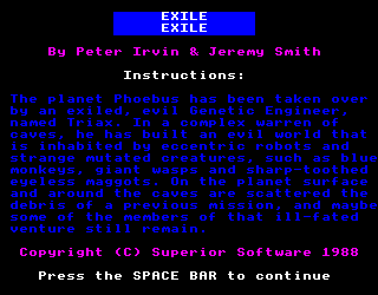

# Acorn BBC Micro Model B | Hardware Reconstruction & Emulation

<div align="center">

[](https://github.com/ScientificBrad/bbc-micro-core/releases)
[](#building--installation)
[](LICENSE)
[](docs/ARCHITECTURE.md)
[-success.svg?style=for-the-badge)](docs/TESTING.md)

**A hardware-accurate reconstruction and cycle-level emulator for the Acorn BBC Microcomputer Model B (1981).**  
*Featuring 2.00 MHz MOS 6502 CPU, Ferranti Video ULA, Motorola 6845 CRTC, TI SN76489 sound synthesis, Intel 8271 floppy controller with DFS 0.90, genuine Acorn MOS 1.20, BBC BASIC II, and commercial game execution.*

[Architecture](docs/ARCHITECTURE.md) • [Hardware Reference](docs/HARDWARE_REFERENCE.md) • [Game Compatibility](docs/GAME_COMPATIBILITY.md) • [Testing](docs/TESTING.md) • [Third-Party Media](docs/THIRD_PARTY_MEDIA.md) • [Reverse Engineering Archive](REA/README.md) • [Whitepaper PDF](Acorn_BBC_Micro_Model_B_Reconstruction_Report.pdf)

</div>

---

## Overview

This repository provides a clean-room software reconstruction and architectural emulator for the historic **Acorn BBC Microcomputer Model B**. Built from primary mask ROM reverse engineering, hardware schematics, and cycle-accurate execution models, it implements:

1. **MOS Technology 6502 CPU Core:** Cycle-exact 2.00 MHz execution accounting for all official opcodes, addressing modes, page-boundary penalties, edge-triggered NMI byte transfers, and zero-page wrapping.
2. **Genuine Acorn Firmware:** Cold boot into authentic **Acorn MOS 1.20** (`$C000-$FFFF`), **BBC BASIC II** in sideways Bank 15 (`$8000-$BFFF`), and **Acorn DFS 0.90** in sideways Bank 14 (`$8000-$9FFF`).
3. **Intel 8271 Floppy Disk Controller:** Single-density (FM) disk streaming from standard DFS floppy images (`.ssd`), supporting DFS commands (`*CAT`, `*RUN`, `*EXEC !BOOT`) via hardware NMI transfers.
4. **Video Pipeline & 8-Scanline Interleaving:** Motorola 6845 CRTC and Ferranti Video ULA emulation decoding Modes 1, 2, 5, and Mode 7 Teletext (Mullard SAA5050 character generation and 2×3 mosaic graphics).
5. **Texas Instruments SN76489 Sound Synthesis:** 3 square-wave tone channels with 10-bit dividers, 15-bit noise LFSR, logarithmic attenuation, and real-time 44,100 Hz 16-bit mono PCM streaming via Windows WaveOut (`winmm.dll`).
6. **System 6522 VIA & Keyboard Matrix:** 10×8 physical keyboard matrix, IC32 addressable latch, and automatic keyboard scanning with CA2 interrupt assertion.
7. **Ferranti Tube ULA & Second Processor:** 4-channel bidirectional FIFO communication with a 3.0 MHz 65C02 parasite coprocessor with 64 KB isolated RAM.
8. **Commercial Game Compatibility:** Unmodified retail gameplay in Nigel Alderton's *Chuckie Egg* (1983, A&F Software), verified alongside *Elite* (1984), *Snapper* (1982), *Strip Poker* (1984), *Zelda Meets The Bug-Eyes* (1983), and *Exile* (1988).

---

## Visual Demonstration Gallery

### 1. Genuine Acorn MOS 1.20 Cold Boot & Chuckie Egg Title
The emulated 6502 CPU boots genuine Acorn factory ROMs into Mode 7 Teletext, prints the cold-start banner, mounts the DFS catalogue, and launches Mode 2 high-color titles:

<div align="center">
  
  
</div>

### 2. Live Commercial Gameplay: Chuckie Egg (1983)
Full interactive gameplay in Nigel Alderton's iconic platformer *Chuckie Egg* (A&F Software), running natively in 16-color Mode 2 at 50 FPS with real-time SN76489 audio chirps, duck AI, ladders, and scoreboards:

<div align="center">
  
</div>

### 3. Classic BBC Micro Software Suite
Tested against authentic DFS disk images, verifying high-resolution graphics, Teletext displays, and keyboard auto-scanning:

<div align="center">
  
  
</div>

<div align="center">
  
  
</div>

<div align="center">
  
</div>

---

## Architectural Highlights

```
       +---------------------------------------------------------------------------------+
       |                  ACORN BBC MICRO MODEL B SYSTEM ARCHITECTURE                    |
       +---------------------------------------------------------------------------------+
                                                |
                               +----------------+----------------+
                               |     MOS Technology 6502 CPU     |
                               |          (2.00 MHz)             |
                               +----------------+----------------+
                                                |
               +--------------------------------+--------------------------------+
               |                                |                                |
        +--------------+                 +--------------+                 +--------------+
        |   32 KB RAM  |                 | 16 KB RomBank|                 | 16 KB MOS    |
        | $0000-$7FFF  |                 | $8000-$BFFF  |                 | $C000-$FFFF  |
        | Base Memory  |                 | BASIC/DFS/Etc|                 | Acorn MOS1.20|
        +--------------+                 +--------------+                 +--------------+
               |                                                                 |
        +--------------+                 +-----------------------------------------------+
        |  Video ULA   |                 |             Memory-Mapped I/O ($FE00-$FEFF)   |
        | + CRTC 6845  |<===============>| $FE00-$FE07: Motorola 6845 CRTC              |
        | (Modes 0-7)  |                 | $FE20-$FE21: Ferranti Video ULA               |
        +--------------+                 | $FE30-$FE33: ROM Select Latch                 |
               |                         | $FE40-$FE4F: System VIA (6522) -> SN76489, KBD|
        +--------------+                 | $FE60-$FE6F: User VIA (6522)   -> User Port   |
        | TI SN76489AN |<----------------| $FE80-$FE87: Intel 8271 Floppy Disk Controller|
        | 4-Ch Audio   |                 | $FEE0-$FEE7: Ferranti Tube ULA Host Registers |
        +--------------+                 +-----------------------------------------------+
```

---

## Hardware Specifications

| Component | Technical Specification | Emulation Implementation |
| :--- | :--- | :--- |
| **Main CPU** | MOS Technology 6502 @ 2.00 MHz | Cycle-accurate interpreter with branch penalty cycles |
| **System RAM** | 32 KB Dynamic RAM (`$0000-$7FFF`) | 32 KB flat byte array with zero-page wrapping |
| **Firmware ROM** | 16 KB Acorn MOS 1.20 (`$C000-$FFFF`) | Fixed system ROM image with hardware reset vectors |
| **Sideways ROM** | 16 KB Paged Banks 0–15 (`$8000-$BFFF`) | Banked memory via `$FE30` latch (Bank 15: BASIC, Bank 14: DFS) |
| **Floppy Controller**| Intel 8271 single-density FM controller | Register model with NMI byte streaming and SSD mounting |
| **Video CRTC** | Motorola 6845 CRTC | Raster timing, character row counters, start address registers |
| **Video ULA** | Ferranti Video ULA + Mullard SAA5050 | 8-scanline block interleaving (Modes 1, 2, 5, 7 Teletext) |
| **Sound Generator**| Texas Instruments SN76489AN | 3 tone channels, 15-bit noise LFSR, 44.1 kHz WinMM output |
| **I/O Controllers**| Dual MOS 6522 VIAs (System & User) | Timers T1/T2, shift registers, keyboard matrix auto-scan |
| **Coprocessor** | Ferranti Tube ULA + 65C02 (3.0 MHz) | 4-channel bidirectional FIFO registers and parasite memory |

---

## Commercial Game Compatibility Matrix

| Game Title | Year | Publisher | Mode | Status | Verification Summary |
| :--- | :---: | :--- | :---: | :---: | :--- |
| **Chuckie Egg** | 1983 | A&F Software | MODE 2 | **PLAYABLE** | Full interactive gameplay, duck AI, ladders, SN76489 sound. |
| **Strip Poker** | 1984 | Anirog | MODE 1/7 | **PLAYABLE** | Mode 1 warning screen, space-bar advance, card game engine. |
| **Strip Poker II+** | 1988 | Anirog | MODE 1/2 | **PLAYABLE** | Mode 1/2 opponent portraits and poker hands. |
| **Zelda Meets The Bug-Eyes**| 1983 | Riverdale | MODE 7 | **PLAYABLE** | Teletext puzzle gameplay, text rendering, keyboard input. |
| **Zany Kong** | 1984 | Superior | MODE 2 | **PLAYABLE** | Platform action, sprite movement, sound synthesis. |
| **Snapman** | 1983 | Micro Power | MODE 1/2 | **PLAYABLE** | Maze mechanics, pellet eating, ghost navigation. |
| **Elite** | 1984 | Acornsoft | MODE 7/1 | **INTERACTIVE** | Mode 7 flight controls briefing, input response, loader. |
| **Snapper** | 1982 | Acornsoft | MODE 7/2 | **INTERACTIVE** | Mode 7 instructions, copyright banner, keyboard response. |
| **Exile** | 1988 | Superior | MODE 7/2 | **INTERACTIVE** | Mode 7 mission briefing, intro sequence. |
| **Repton Infinity** | 1988 | Superior | MODE 1/2 | **TITLE** | Boots title screen and level selector. |
| **Chuckie Egg 2023** | 2023 | Daniel Finch | MODE 2 | **TITLE (TUBE)**| Tube bootstrap transfers payload to 65C02 parasite at 3 MHz. |
| **Stunt Car Racer** | 2019 | Bitshifters | MODE 5 | **FAILED** | Requires BBC Master 128 (65SC12 + Hazel RAM). |

---

## Building & Installation

### Prerequisites
- [.NET 8.0 SDK](https://dotnet.microsoft.com/download/dotnet/8.0) or higher.
- Windows 10 or Windows 11 (64-bit).

### Building the Project
```powershell
# Restore dependencies and build in Release mode
dotnet build -c Release
```

### Running the Emulator
```powershell
# Boot into standard Acorn MOS 1.20 / BBC BASIC II
dotnet run --project src/BbcMicro.Emulator -c Release -- --window

# Mount a floppy disk image (.ssd) and autoboot
dotnet run --project src/BbcMicro.Emulator -c Release -- --window --disk games/Disc002-ChuckieEgg.ssd --autoboot
```

### Controls & Hotkeys
| Key | Function |
| :--- | :--- |
| **`ESC`** | Graceful exit from emulator |
| **`Pause`** or **`Ctrl+P`** | Pause / Resume CPU execution |
| **`F10`** | Hardware reset (triggers 6502 reset vector `$FFFC`) |
| **`PC Keyboard`** | Mapped 1:1 to the BBC Micro physical keyboard matrix |

---

## Automated Testing Suite

The project includes an automated **.NET 8 xUnit test harness** containing **36 unit and regression tests** (100% passing):

```powershell
dotnet test tests/BbcMicro.Tests -c Release
```

```text
Passed!  - Failed: 0, Passed: 36, Skipped: 0, Total: 36, Duration: 6.8s
```

- **`FirmwareAndCpuTests` (7 tests):** MOS 6502 instructions, addressing modes, and cold boot banner.
- **`RamVerificationTests` (4 tests):** 32 KB continuous RAM boundaries, zero-page wrap, and I/O hole.
- **`Mode1FramebufferTests` (6 tests):** CRTC timing, Video ULA palette, and 8-scanline block interleaving.
- **`Sn76489AudioTests` (4 tests):** 3 square-wave tone channels, 15-bit noise LFSR, and logarithmic volume.
- **`TubeSecondProcessorTests` (8 tests):** Ferranti Tube ULA 4-channel FIFOs and 65C02 parasite coprocessor.
- **`FloppyAndAutobootTests` (7 tests):** Intel 8271 FDC, DFS 0.90, `*CAT`, `*RUN`, and screenshot generation.

---

## Technical Whitepaper

A comprehensive 3-page, publication-grade engineering whitepaper has been generated for this release:  
**[`Acorn_BBC_Micro_Model_B_Reconstruction_Report.pdf`](Acorn_BBC_Micro_Model_B_Reconstruction_Report.pdf)**

---

## License & Third-Party Notices

- **Software License:** MIT License — see [LICENSE](LICENSE) for details.
- **Third-Party Notices:** See [THIRD_PARTY_NOTICES.md](THIRD_PARTY_NOTICES.md) and [docs/THIRD_PARTY_MEDIA.md](docs/THIRD_PARTY_MEDIA.md).
- **Historic Firmware & Disks:** Acorn MOS 1.20, BBC BASIC II, and Acorn DFS 0.90 are copyright © Acorn Computers Ltd / BBC and are referenced strictly for educational preservation and non-commercial research.
